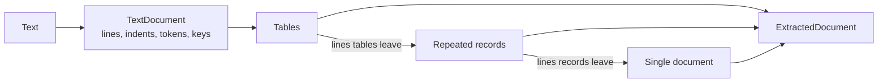

# JMW.TextExtraction

Reads semi-structured text, such as network device command output, without a hand-written parser. Give it a few samples of a command's output and it works out the layout: the tables, the repeated records, and the lines worth reading in a one-off document. It writes that layout as a short spec you can read and correct, then reads any number of further samples with it.

Everything it does is deterministic: tokenizing, alignment, counting, and comparison of samples. There is no model or learning step.

- [Quick start](#quick-start)
- [How it reads text](#how-it-reads-text)
- [The spec format](#the-spec-format)
- [What comes out](#what-comes-out)
- [Building blocks](#building-blocks)
- [Examples](#examples)
- [Accuracy](#accuracy)
- [Limits](#limits)

## Quick start

```csharp
using JMW.TextExtraction;

// Infer a spec from samples of one command's output.
DocumentSpec spec = TextExtractor.Infer(sample1, sample2, sample3);

// Write it out to read, correct, and keep.
File.WriteAllText("show-cdp-neighbors-detail.spec", SpecText.Write(spec));

// Later, read new output with the kept spec.
DocumentSpec kept = SpecText.Read(File.ReadAllText("show-cdp-neighbors-detail.spec"));
ExtractedDocument read = TextExtractor.Extract(kept, newOutput);

foreach (ExtractedRecord neighbor in read.Records)
{
    Console.WriteLine($"{neighbor["Device ID"]} on {neighbor["Interface"]}");
}
```

`TextExtractor.Extract` reads formats the spec does not know with specs inferred from the text itself, unless you pass `inferUnknown: false`. Lines nothing accounts for are listed in `ExtractedDocument.Unclaimed`, so you can see what a spec misses.

The package targets `net10.0`, unlike the repository's other packages, which target `netstandard2.0`.

## How it reads text



The text is read once into a `TextDocument`: each line's kind (blank, rule, content), indent, tokens, and key. Each stage then takes the lines the stage before it left.

**Tables** are found by where values sit, not by what they say. A character position that is blank in every row is a gap between columns, and the header names the columns between the gaps. Three layouts are recognized:

| Layout | Looks like | Columns come from |
|---|---|---|
| `aligned` | `show ip interface brief`, `df` | Blank positions shared by every row, joined and named by the header |
| `ruled` | `show vlan brief`, `tasklist` | The dashed rule under the header |
| `words` | `ps aux`, ASA `show arp` | Whitespace-separated words, for rows that drift out of alignment or have no header |

Header names padded apart by two or more spaces split values that run together, a header line holding `key:`, numbers, or legend dashes is not a header, a second header line is joined to the first, and a row with an empty first cell continues the row above.

**Repeated records** are the units that repeat within a sample, such as one neighbor in `show cdp neighbors detail` or one interface in `show interfaces`. Each way of splitting the text is tried, and the split whose records share the most keys wins:

| Boundary | Records start or split at |
|---|---|
| `rule` | Rule lines such as `----------` |
| `blank` | Blank lines |
| `key "Device ID:"` | Each line with that key |
| `indent` | Each line at the outer indent, or at a given deeper one, with deeper lines below it |
| `phrase "line protocol is"` | Each line holding that run of words, for records that open with their own name |

Within a record, lines are matched across records by their key: the words before each `:` or `=`, or a line's first word, or for a line opening with a number, the number's shape and the plain words after it. A key alone on its line, or a line with deeper lines below it, heads a group, and the group's lines carry its name: `Entry address(es) / IP address`.

**A single document** is output that is one record per sample, such as `show version` or `show ntp status`. Nothing repeats within it, so its lines are matched across samples instead, and a line opening with a device's own name, as `dist-sw1 uptime is 2 years`, is matched by the words after the name.

Every kind of line is described by a **template**: the words every instance shares, and slots for the words that change. Templates are built by aligning all instances of a line (their longest common subsequence), keeping a word when at least 80% of instances hold it, so one odd line does not erase the rest. A key with several shapes, as `Encapsulation ARPA` and `Encapsulation 802.1Q Virtual LAN, Vlan ID 100`, gets one template per shape.

## The spec format

A spec is plain text, one directive per line. `#` starts a comment, and keywords match regardless of case.

```
table aligned header: Port | Name | Status | Vlan | Duplex | Speed | Type
table words headerless: 4

records split by rule
  line "Device ID:" => Device ID: {Device ID}
  line "Platform: Capabilities:" => Platform: {Platform} , Capabilities: {Capabilities}
  line "Interface: Port ID :" => Interface: {Interface} , Port ID {?Port ID qualifier} : {Port ID}
  text "Version :" => Version : {Version}

records start at phrase "line protocol is", head
  line "@head" => {Name} is {Status} , line protocol is {line protocol}
  line "MTU" => MTU {MTU} bytes , BW {BW} Kbit/sec , DLY {DLY} usec ,

single
  line "* uptime is" => {Name} uptime is {uptime}
  line "System image file is" => System image file is {System image file}
```

| Directive | Means |
|---|---|
| `table <aligned\|ruled\|words> header: A \| B \| C` | A table with these columns. Positions are found again in each sample, so only names are kept. |
| `table <layout> headerless: N` | A table with no header and N columns, named `Column1` to `ColumnN`. |
| `records split by rule\|blank\|indent [N]` | Records split at rule lines, blank lines, or each line at the outer indent or at indent N. |
| `records start at key "K"` | Each record starts at a line keyed K. |
| `records start at phrase "P"` | Each record starts at a line holding the words P. |
| `, head` after a records directive | A record's first line is keyed `@head` by its place, not its words. |
| `single` | The lines after it read the rest of the document as one record. |
| `line "<key>" => <template>` | A line and how to read it. |
| `text "<key>" => <template>` | A key whose value is the text below it, up to a blank line. |

In a template, `{Name}` is a value, `{?Name}` is a qualifier on the key (the `(MAC address)` in `Chassis ID (MAC address):`), and any other word must appear in the line. A word starting with `{` or `\` is escaped with `\`. Errors name the line: `line 3: a { has no closing }`.

Reading is forgiving. Words match regardless of case and spacing, a line matches when at least half its template's words are found, and a value is the text between the nearest words found on either side.

## What comes out

`ExtractedDocument` holds the tables, the records, the single-document record, and the unclaimed lines. Each table row and record is an `ExtractedRecord`: its line range, its fields in order, and the lines inside it that no template matched.

An `ExtractedField` has:

| Member | Holds | From `Chassis ID (MAC address): 0200.5e50.c200` |
|---|---|---|
| `Name` | The field as the spec names it | `Chassis ID` |
| `Value` | The value, with one pair of enclosing quotes, brackets, or parentheses removed | `0200.5e50.c200` |
| `Qualifier` | A parenthetical on the key | `MAC address` |
| `Unit` | A unit after a number, as `bytes` in `MTU 1500 bytes` | |
| `Key` | `Name` with its qualifier, as the text wrote it | `Chassis ID (MAC address)` |

`record["Name"]` returns the first value of a field, or null.

`record.ToDictionary()` maps each field name to its value. A name read more than once, such as several addresses on one interface, maps to an array in the order read. A qualifier or unit is listed under `"<name> qualifier"` or `"<name> unit"` in the same shape, with null for a repeat that had none.

`document.ToJson()` writes the whole result using System.Text.Json:

```json
{
  "tables": [[{ "Interface": "GigabitEthernet0/0", "Status": "up" }]],
  "records": [{ "Neighbor": "10.1.1.1", "State": "Full", "Uptime": "3d" }],
  "single": null,
  "unclaimed": []
}
```

## Building blocks

Each stage is public, so you can stop at any level or build your own pipeline.

| Namespace | Types | Does |
|---|---|---|
| `JMW.TextExtraction.Text` | `TextDocument`, `TextLine`, `Tokenizer`, `LineKeys`, `Lines`, `Cells` | Lines, tokens, keys, and value helpers |
| `JMW.TextExtraction.Tables` | `TableDetector`, `TableInference`, `TableExtractor`, `TableSpec` | Finding, describing, and reading tables |
| `JMW.TextExtraction.Records` | `RecordSegmenter`, `RecordLines`, `LineTemplate`, `RecordInference`, `RecordExtractor`, `SampleFormats` | Splitting records, line templates, grouping samples by format |
| `JMW.TextExtraction.Singles` | `SingleInference`, `SingleExtractor` | One-record-per-sample output |
| `JMW.TextExtraction` | `TextExtractor`, `SpecText`, `DocumentSpec` | The whole pipeline and the spec format |

`RecordInference.InferFormats` groups samples by the keys they hold before inferring, so output from several platforms gets one spec per platform. `RecordExtractor.ExtractOrInfer` reads with the best-fitting known spec, or infers one from the text when none fits.

## Examples

`JMW.TextExtraction.Tests/Examples` holds hand-written samples of the layouts real devices print, with made-up names and documentation addresses, one folder per command and platform. Each folder has its inputs, the spec inferred from them (`spec.txt`), and what each input reads as (`input-N.expected.txt`). `ExampleTest` checks them all.

When a library change changes what is read, run the explicit `WriteExpectations` test to rewrite the expected files, and review the diff line by line before keeping it. Layouts the library does not handle sit under `Examples/unsupported`, so their output is pinned too.

## Accuracy

`tools/measure-text-extraction.cs` compares what the library reads against the values hand-written parsers read from the same text, using corpora kept outside this repository:

```
dotnet run tools/measure-text-extraction.cs -- golden <folder of command folders> [command path...] [--verbose]
dotnet run tools/measure-text-extraction.cs -- coverage <folder of device folders> [min samples] [max samples]
```

Each expected value is counted as exact, coarser (inside a value read), finer (holding a value read, as `1500 bytes` against `1500`), missed, or derived (not in the text at all, such as a constant the parser adds).

## Limits

- **Free-form statements.** Access lists, routing tables, and configuration files are lists of statements, not keyed lines, so few keys recur. They read as unclaimed lines.
- **Text values wrapped at the same indent.** NX-OS continues a system description on unindented lines; those read as lines of their own.
- **Constant phrases.** A phrase that never changes in the samples, as `not present`, is a fixed word of its template, not a value. More varied samples fix this.
- **Rare pairs on a line of pairs.** In `inet 192.0.2.10  netmask 255.255.255.0  broadcast 192.0.2.255`, a pair that appears in only some samples, here `broadcast`, stays inside the value before it.
- **Keyless lines seen once.** A line with no separator that turns up in one record, as `loop` in Linux `ifconfig`, has nothing to compare against and is unclaimed.
- **Keys padded from their values with no separator.** F5 and Avaya print `Maximum MAC Count  2` with spaces alone between key and value. A block of such lines reads as a two-column table whose first line is the header, since a two-column table row such as `master      forwarding` looks the same.
- **Records whose lines carry optional pairs.** FortiOS prints each interface as one line of `key: value` pairs, and the set of keys differs by interface type, so the lines key differently and the records do not score as alike. The values are read, as numbered fields of one document.
- **Columns that are always empty.** A header word over a column with no data in any sample can't be told from the second word of its neighbor's name when single-spaced from it.
